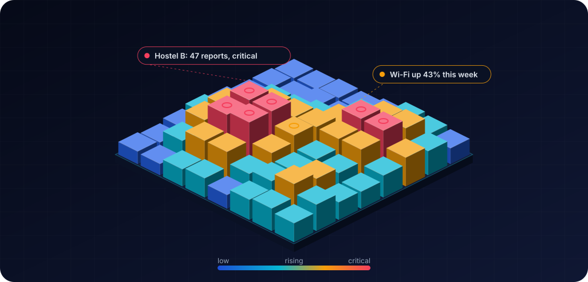
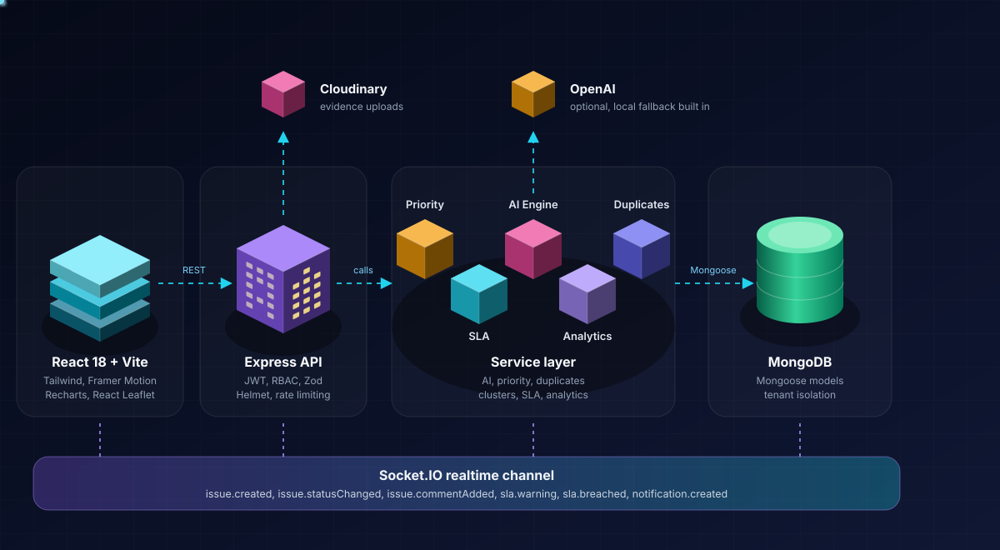
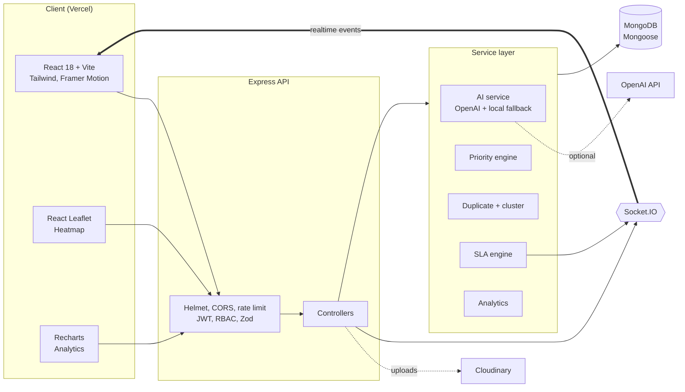
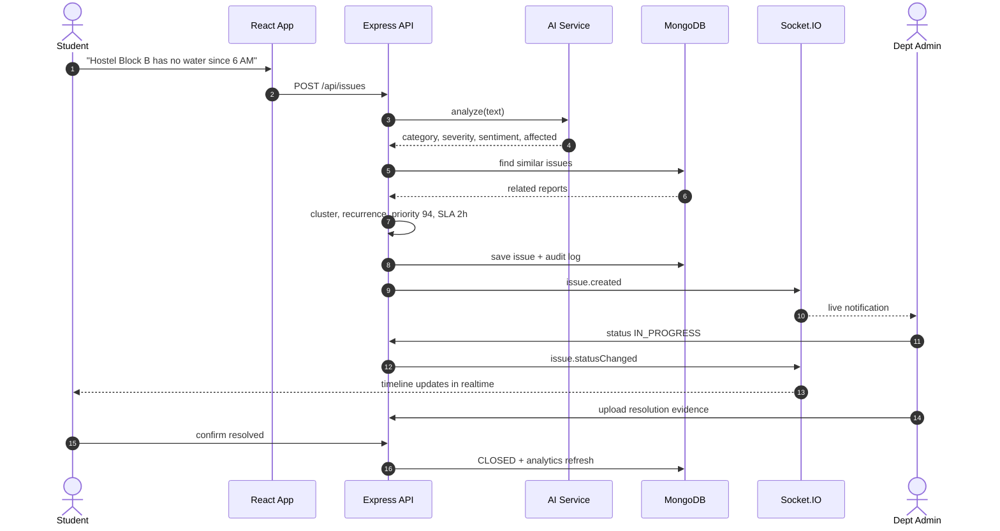
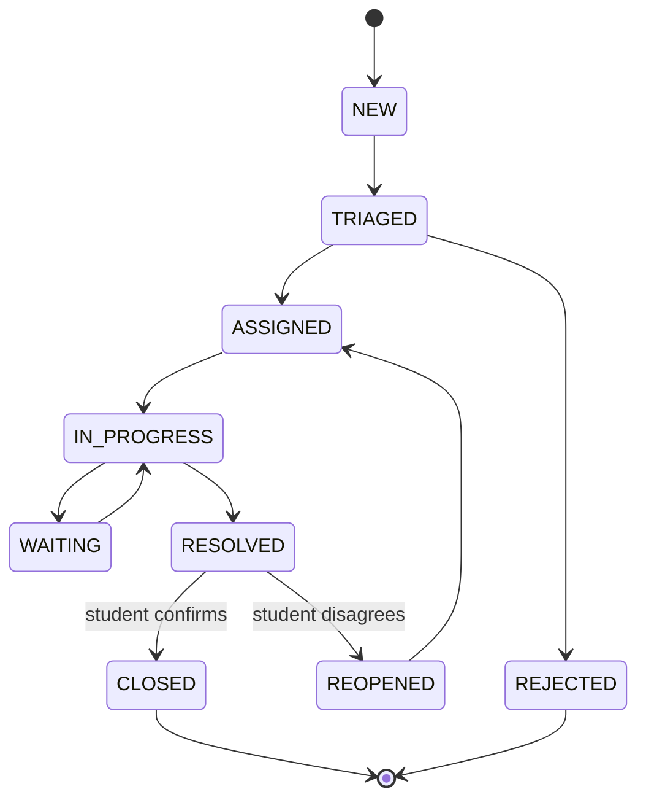

<div align="center">



<br/>

<a href="https://campus-pluse-ai-phi.vercel.app/">
  
</a>

<br/>

[](https://campus-pluse-ai-phi.vercel.app/)
[](https://campus-pluse-ai-backend.vercel.app)
[](#-license)


<br/>

**[Live Demo](https://campus-pluse-ai-phi.vercel.app/)** &nbsp;|&nbsp; **[Overview](#-overview)** &nbsp;|&nbsp; **[AI Pipeline](#-ai-pipeline)** &nbsp;|&nbsp; **[Architecture](#-architecture)** &nbsp;|&nbsp; **[Quick Start](#-quick-start)** &nbsp;|&nbsp; **[API](#-realtime-events)** &nbsp;|&nbsp; **[Roadmap](#-roadmap)**

</div>

<br/>

---

<div align="center">

## 🎯 Overview

**Not another complaint portal.**

CampusPulse turns scattered student feedback into prioritized, explainable, actionable insight, so institutions find problems faster, respond smarter, and build better campuses.

It answers one question:

### *What campus problem should be solved first, why does it matter, and what action should be taken?*

<br/>

| 😵 Before CampusPulse | ⚡ With CampusPulse |
|:---|:---|
| Issues arrive over WhatsApp, email, and paper notes | One central, multi-tenant platform |
| 40 students report the same water outage separately | Duplicates detected and merged into one cluster |
| Critical issues are buried under low-priority requests | Explainable priority score from 0 to 100 |
| No SLA, no ownership, no accountability | SLA timers, auto-routing, live breach alerts |
| Recurring problems are never noticed | Recurrence detection and predictive alerts |
| Admins guess where to look | Live campus heatmap and AI recommendations |

</div>

<br/>

---

<div align="center">

## 🧠 AI Pipeline

Every report passes through eight stages in seconds, with no manual triage.



</div>

<br/>

<div align="center">

| Stage | What happens | Example |
|:---:|:---|:---|
| **Understand** | NLP reads the free-text complaint (OpenAI or local fallback) | *"Hostel Block B has no water since 6 AM"* |
| **Classify** | Maps the issue to Water, Electricity, Wi-Fi, Hostel, Transport, Food, and more | Water + Hostel |
| **Analyze** | Estimates severity, sentiment, and affected users | Severity 8, negative, about 200 students |
| **Deduplicate** | TF-IDF cosine similarity plus location, category, and time match | above 0.85 likely duplicate, 0.65 to 0.85 related |
| **Cluster** | Groups related reports into one problem | *Hostel B Water Crisis: 47 reports, 630 affected* |
| **Recurrence** | Looks for repeat patterns across weeks | Wi-Fi: Jan 4, Feb 8, Mar 13, Apr 21 flagged |
| **Prioritize** | Computes a transparent score with reasons | **94 / 100** |
| **Route + SLA** | Assigns the right department and starts the clock | Hostel Maintenance, 2h resolution |

</div>

<br/>

---

<div align="center">

## ✨ Features

</div>

<table align="center">
<tr>
<td width="50%" valign="top">

### 🧩 Intelligence
- AI complaint understanding with **Local** and **Enhanced** modes
- Duplicate detection and issue clustering
- Recurrence detection across weeks
- Explainable priority scoring with reasons
- Predictive alerts, for example *"Wi-Fi congestion expected Monday 9 to 11 AM"*
- AI recommendations panel with evidence and next action
- Campus Health Score from 0 to 100

</td>
<td width="50%" valign="top">

### 🛠️ Operations
- Priority Queue: **"What should we fix first?"**
- SLA tracking with warning and breach states
- Auto-assignment to the right department
- Status workflow with a visual timeline
- Voting, following, and resolution confirmation
- Anonymous reporting with privacy controls
- Full audit log of every admin action

</td>
</tr>
<tr>
<td width="50%" valign="top">

### 🗺️ Visibility
- Interactive campus heatmap (React Leaflet)
- Analytics: volume, category, department, resolution time, SLA performance, sentiment
- Trend detection, for example *Internet +43% this week*
- 8-step issue wizard with live AI preview
- Evidence uploads (JPG, PNG, WEBP, PDF)

</td>
<td width="50%" valign="top">

### 🏢 Platform
- Multi-tenant: Organization, Campus, Department, Users, Issues
- Roles: Student, Faculty, Department Admin, Campus Admin, Super Admin
- Realtime updates through Socket.IO
- JWT auth, RBAC, tenant isolation on every document
- Docker Compose for a one-command local stack

</td>
</tr>
</table>

<br/>

---

<div align="center">

## 🗺️ Campus Heatmap

Each column is a campus zone. Height and color show issue intensity, and the pulsing rings mark live hotspots.



</div>

<br/>

---

<div align="center">

## 🏗️ Architecture



</div>

<br/>

### System flow



### Request lifecycle



### Layer responsibilities

| Layer | Responsibility | Key tech |
|:---|:---|:---|
| **Presentation** | Wizard, dashboards, priority queue, heatmap, analytics | React 18, Vite, Tailwind, Framer Motion, Recharts, React Leaflet |
| **API** | Routing, validation, auth, RBAC, rate limiting, error handling | Express, JWT, Zod, Helmet, express-rate-limit |
| **Service** | Business logic kept separate from controllers | `services/ai`, `priority`, `duplicate`, `analytics`, `sla` |
| **AI** | Independent layer with a deterministic keyword fallback, so the app works without an API key | OpenAI (optional), TF-IDF cosine |
| **Data** | Tenant-scoped documents and audit trail | MongoDB, Mongoose |
| **Realtime** | Push events to students and admins | Socket.IO |
| **Storage** | Evidence uploads | Cloudinary, or local `/uploads` for demos |

<br/>

---

<div align="center">

## 📊 Explainable Priority Engine

No black box. Every score comes with the reasons behind it.

</div>

```text
Priority = Severity x 30 + Affected x 25 + Recurrence x 20 + Urgency x 15 + Sentiment x 10
           (each factor normalized, final score scaled to 0 - 100)
```

<div align="center">

| Rank | Issue | Priority | Affected | Recurrence | SLA left |
|:---:|:---|:---:|:---:|:---:|:---:|
| 🔴 1 | Water outage, Hostel B | **96** | 430 | High | 1h 42m |
| 🟠 2 | Wi-Fi congestion, Library | **81** | 310 | Medium | 3h 10m |
| 🟡 3 | Power fluctuation, Block C | **67** | 120 | Low | 6h 05m |

*Sample data from the seeded demo.*

### ⏱️ SLA Intelligence

| Priority | First response | Resolution |
|:---:|:---:|:---:|
| 🔴 Critical | 15 minutes | 2 hours |
| 🟠 High | 1 hour | 8 hours |
| 🟡 Medium | 4 hours | 24 hours |
| 🟢 Low | 24 hours | 72 hours |

Warnings and breaches are pushed live through `sla.warning` and `sla.breached`.

</div>

<br/>

---

<div align="center">

## 🔄 Issue Status Workflow

</div>



<br/>

---

<div align="center">

## 🧰 Tech Stack


</div>

<br/>

| | Technologies |
|:---|:---|
| **Frontend** | React 18, Vite, Tailwind CSS, React Router, Axios, Lucide React, Framer Motion, Recharts, React Leaflet, Socket.IO Client, React Hook Form, Zod, Sonner |
| **Backend** | Node.js, Express.js, MongoDB, Mongoose, JWT, bcryptjs, Socket.IO, Multer, Helmet, CORS, express-rate-limit, Morgan, Winston, dotenv |
| **AI** | OpenAI API (optional) with a deterministic local fallback, TF-IDF cosine similarity |
| **Storage** | Cloudinary, or local uploads |
| **DevOps** | Docker Compose, Vercel |

<br/>

---

## 📁 Project Structure

```text
CampusPulse/
├── frontend/
│   └── src/
│       ├── components/   # ui, common, issues, admin
│       ├── pages/        # auth, issues, admin
│       ├── layouts/  hooks/  context/  routes/  charts/
│       ├── services/     # API + socket clients
│       └── App.jsx
├── backend/
│   └── src/
│       ├── config/  controllers/  middleware/  models/  routes/
│       ├── services/
│       │   ├── ai/         # OpenAI + local fallback
│       │   ├── priority/   # explainable scoring
│       │   ├── duplicate/  # TF-IDF + clustering
│       │   ├── analytics/
│       │   └── sla/
│       ├── sockets/  validators/  seeds/  utils/
│       └── app.js
├── docs/                   # architecture, api, database, deployment
├── docker-compose.yml
└── README.md
```

<br/>

---

## 🚀 Quick Start

### Prerequisites

- Node.js 18 or newer
- MongoDB (local, or a free [Atlas](https://www.mongodb.com/atlas) cluster)

### 1. Clone

```bash
git clone https://github.com/sathi2305/Campus-Pluse-AI.git
cd Campus-Pluse-AI
```

### 2. Backend

```bash
cd backend
cp .env.example .env      # then edit the values below
npm install
npm run seed              # demo accounts + 100+ realistic issues
npm run dev               # http://localhost:5000
```

### 3. Frontend

```bash
cd ../frontend
cp .env.example .env
npm install
npm run dev               # http://localhost:5173
```

### Or run everything with Docker

```bash
docker-compose up --build
```

<br/>

### 🔐 Environment Variables

<details>
<summary><b>Backend <code>.env</code></b></summary>

```env
PORT=5000
NODE_ENV=development
MONGO_URI=mongodb://localhost:27017/campuspulse
JWT_SECRET=your_super_secret
JWT_EXPIRES_IN=7d
CLIENT_URL=http://localhost:5173

# Optional: the app works fully without these
OPENAI_API_KEY=
AI_MODEL=gpt-4o-mini
CLOUDINARY_CLOUD_NAME=
CLOUDINARY_API_KEY=
CLOUDINARY_API_SECRET=
```

</details>

<details>
<summary><b>Frontend <code>.env</code></b></summary>

```env
VITE_API_URL=http://localhost:5000/api
VITE_SOCKET_URL=http://localhost:5000
```

</details>

<details>
<summary><b>AI modes</b></summary>

| Mode | When | What you get |
|:---|:---|:---|
| **Local Intelligence** | No `OPENAI_API_KEY` | Deterministic keyword mapping (water, pipeline, tap to Water; wifi, internet, router to Internet) |
| **Enhanced Intelligence** | `OPENAI_API_KEY` set | Richer classification, sentiment, and summaries |

The UI always shows which mode is active. Keys are never hard-coded.

</details>

<details>
<summary><b>Cloudinary (optional)</b></summary>

Add your cloud name, key, and secret to the backend `.env`. If they are missing, evidence uploads are stored locally in `/uploads`, which is fine for demos.

</details>

<br/>

### 🔑 Demo Credentials

| Role | Email | Password |
|:---|:---|:---|
| Student | `student@campuspulse.demo` | `Student@123` |
| Campus Admin | `admin@campuspulse.demo` | `Admin@123` |
| Department Admin | `department@campuspulse.demo` | `Department@123` |

The seed script creates 3 campuses, 10 departments, 50 users, and 100+ issues, including duplicates, recurring problems, critical cases, SLA breaches, comments, votes, and notifications.

<br/>

---

<div align="center">

## 📡 Realtime Events

</div>

| Event | Fired when |
|:---|:---|
| `issue.created` | A new issue is reported |
| `issue.updated` | Issue details change |
| `issue.assigned` | A department or staff member is assigned |
| `issue.statusChanged` | Status moves along the workflow |
| `issue.commentAdded` | Someone comments |
| `issue.resolved` | A resolution is submitted |
| `notification.created` | A user notification is generated |
| `sla.warning` | An SLA deadline is close |
| `sla.breached` | An SLA deadline is missed |

Full REST reference: [`docs/api.md`](docs/api.md)

<br/>

---

<div align="center">

## 🛡️ Security

</div>

| | |
|:---|:---|
| 🔐 **Auth** | JWT with bcrypt-hashed passwords |
| 👥 **Access** | Role-based access control and tenant isolation on every document |
| 🧱 **Hardening** | Helmet, CORS, rate limiting, secure headers |
| 🧼 **Input** | Zod validation, mongoSanitize, xss-clean |
| 📎 **Uploads** | MIME type and size validation |
| 🧯 **Errors** | Centralized handling, no secrets in code |

<br/>

---

<div align="center">

## ☁️ Deployment

| Part | Where |
|:---|:---|
| **Frontend** | [Vercel](https://campus-pluse-ai-phi.vercel.app/) |
| **Backend API** | [Vercel](https://campus-pluse-ai-backend.vercel.app) |
| **Database** | MongoDB Atlas |
| **AI / Media** | OpenAI and Cloudinary (both optional) |

Step-by-step guide: [`docs/deployment.md`](docs/deployment.md)

</div>

<br/>

---

## 🗓️ Roadmap

- [x] AI classification, severity, and sentiment
- [x] Duplicate detection and clustering
- [x] Explainable priority and SLA engine
- [x] Realtime notifications
- [x] Campus heatmap and analytics
- [ ] Mobile app (React Native)
- [ ] Push notifications (FCM)
- [ ] Embedding model for duplicate detection (sentence-transformers)
- [ ] Auto-routing based on staff availability
- [ ] Voice reporting
- [ ] Multilingual support
- [ ] ERP integration

<br/>

---

## 🤝 Contributing

Contributions are welcome.

1. Fork the repository
2. Create a branch: `git checkout -b feature/your-feature`
3. Commit your changes: `git commit -m "Add your feature"`
4. Push the branch: `git push origin feature/your-feature`
5. Open a pull request

<br/>

---

## 📄 License

Released under the **MIT License**. Built for college projects, hackathons, startup MVPs, portfolios, and university deployments.

<br/>

<div align="center">

### Built by [Sathiyamoorthi S](https://github.com/sathi2305)

If CampusPulse helped you, consider giving it a ⭐

[](https://campus-pluse-ai-phi.vercel.app/)


</div>
